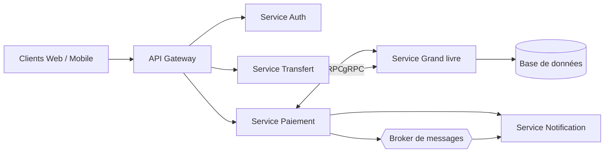

### *Construire l'avenir, un microservice à la fois.*

[English](README.md) · **Français**

 

<table>
<tr>
<td width="62%" valign="top">

## À propos

Architecte logiciel et ingénieur backend passionné par la conception de logiciels sécurisés, scalables et performants. Je me spécialise dans les **systèmes distribués**, les **microservices** et les **plateformes de paiement**.

- **Actuellement :** Head of IT @ NITA Transfert d'Argent
- **Formation :** Master en architecture logicielle
- **Expertise :** Java, Spring Boot, Microservices, gRPC, Cloud (AWS/Azure), React, Flutter

</td>
<td width="38%" valign="top" align="center">

## Statistiques GitHub

</td>
</tr>
</table>

## Expertise principale

| Domaine | Technologies |
| :--- | :--- |
| **Backend** | Java, Spring Boot, Kotlin, NodeJS, NestJS, Laravel |
| **Frontend** | React, Vue, Flutter, React Native |
| **DevOps & Cloud** | Docker, CI/CD, AWS, Azure, Firebase |
| **Base de données** | PostgreSQL, MySQL, MongoDB |
| **Architecture** | Microservices, REST, gRPC, Clean Architecture |

## Projets phares

<table>
<tr>
<td width="25%" valign="top">

#### Payment Platform
Architecture de paiement pour entreprise.

`Java · Spring Boot · gRPC · MySQL · Docker`

</td>
<td width="25%" valign="top">

#### DodaShop
Plateforme e-commerce moderne.

`React · Node.js · Express · MongoDB`

</td>
<td width="25%" valign="top">

#### Spring Boot CRUD Template
Modèle réutilisable avec bonnes pratiques.

`Java · Spring Boot · MongoDB · Swagger · Docker`

</td>
<td width="25%" valign="top">

#### Gestioncar
Solution de gestion de voitures.

`Java · Spring Boot`

</td>
</tr>
</table>

## Architecture de référence : plateforme de paiement

*Vue simplifiée du modèle que j'utilise pour les systèmes de paiement : services indépendants, gRPC pour les appels internes, événements asynchrones pour les notifications.*

<table>
<tr>
<td width="33%" valign="top">

## Me contacter

- **Email** [koisonnmanes@gmail.com](mailto:koisonnmanes@gmail.com)
- **LinkedIn** [linkedin.com/in/koisonn-manes-mana99](https://www.linkedin.com/in/koisonn-manes-mana99/)
- **Portfolio** [koisonnmanes.tech](https://koisonnmanes.tech) · [kmmportfolio.netlify.app](https://kmmportfolio.netlify.app)

</td>
<td width="34%" valign="top">

## Parcours

- **2026 – Aujourd'hui** Head of IT @ NITA Transfert d'Argent
- **2022 – 2025** Développeur Full-Stack / Lead Tech @ ESMC GIE
- **2020 – 2022** Développeur Full-Stack @ JGK TECHNOLOGIE

</td>
<td width="33%" valign="top">

## Certifications

- Foundations of Software Architecture, Packt (2026)
- Microservices Design Patterns, Udemy (2025)
- Introduction to DevOps & Cybersecurity, IBM (2026)

</td>
</tr>
</table>

## Activité de contribution

### Ouvert à de nouvelles opportunités internationales
Construisons quelque chose de grand ensemble.

