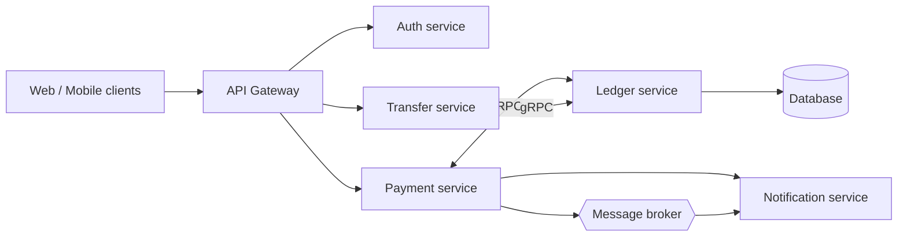

### I design reliable, scalable payment platforms.

**English** · [Français](README.fr.md)

---

## About

Software Architect and Backend Engineer specialised in **distributed systems**, **microservices** and **payment platforms**. I turn complex business needs into clean, secure and maintainable architectures, from system design to production.

- **Now:** Head of IT at NITA Transfert d'Argent
- **Education:** Master's Degree in Software Architecture
- **Focus:** Microservices · Event-driven design · Payment systems · Cloud-native delivery

## Available for

| Architecture & design | Technical audit | Technical leadership |
| :--- | :--- | :--- |
| Microservices, APIs, payment flows | Security, scalability, code quality | Teams, delivery, CI/CD practices |

[**Get in touch →**](mailto:koisonnmanes@gmail.com)

---

## Reference Architecture: Payment Platform

*Simplified view of the architecture pattern I use for payment systems: independent services, gRPC for internal calls, asynchronous events for notifications.*

---

## Featured Projects

<table>
<tr>
<td width="33%" valign="top">

### Payment Platform
Enterprise payment architecture.

`Java` `Spring Boot` `gRPC` `MySQL` `Docker`

</td>
<td width="33%" valign="top">

### DodaShop
Modern e-commerce platform.

`React` `Node.js` `Express` `MongoDB`

</td>
<td width="33%" valign="top">

### Spring Boot CRUD Template
Reusable starter applying best practices.

`Java` `Spring Boot` `MongoDB` `Swagger` `Docker`

</td>
</tr>
</table>

---

## Tech Stack

| Domain | Technologies |
| :--- | :--- |
| **Backend** |       |
| **Frontend & Mobile** |     |
| **Cloud & DevOps** |      |
| **Data** |    |
| **Architecture** | Microservices · REST · gRPC · Clean Architecture |

---

## Experience

| Period | Role | Company |
| :--- | :--- | :--- |
| 2026 – Present | Head of IT | NITA Transfert d'Argent |
| 2022 – 2025 | Full-Stack Developer / Tech Lead | ESMC GIE |
| 2020 – 2022 | Full-Stack Developer | JGK TECHNOLOGIE |

## Certifications

- **Foundations of Software Architecture**, Packt (2026)
- **Introduction to DevOps & Cybersecurity**, IBM (2026)
- **Microservices Design Patterns**, Udemy (2025)

---

## GitHub Activity

  
  

---

## Contact

- **Email:** [koisonnmanes@gmail.com](mailto:koisonnmanes@gmail.com)
- **LinkedIn:** [linkedin.com/in/koisonn-manes-mana99](https://www.linkedin.com/in/koisonn-manes-mana99/)
- **Portfolio:** [koisonnmanes.tech](https://koisonnmanes.tech) · [kmmportfolio.netlify.app](https://kmmportfolio.netlify.app)

