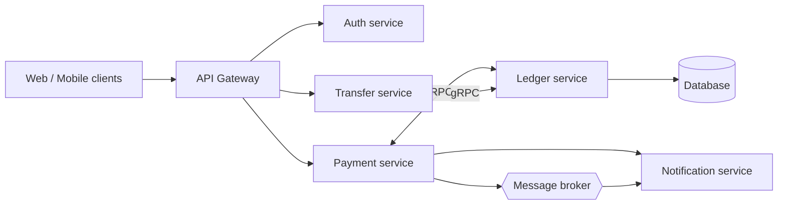

### *Building the future, one microservice at a time.*

**English** · [Français](README.fr.md)

 

<table>
<tr>
<td width="62%" valign="top">

## About Me

I'm a Software Architect and Backend Engineer passionate about building secure, scalable and high-performance software. I specialize in **distributed systems**, **microservices** and **payment platforms**.

- **Currently:** Head of IT @ NITA Transfert d'Argent
- **Education:** Master's Degree in Software Architecture
- **Expertise:** Java, Spring Boot, Microservices, gRPC, Cloud (AWS/Azure), React, Flutter

</td>
<td width="38%" valign="top" align="center">

## GitHub Statistics

</td>
</tr>
</table>

## Core Expertise

| Domain | Technologies |
| :--- | :--- |
| **Backend** | Java, Spring Boot, Kotlin, NodeJS, NestJS, Laravel |
| **Frontend** | React, Vue, Flutter, React Native |
| **DevOps & Cloud** | Docker, CI/CD, AWS, Azure, Firebase |
| **Database** | PostgreSQL, MySQL, MongoDB |
| **Architecture** | Microservices, REST, gRPC, Clean Architecture |

## Featured Projects

<table>
<tr>
<td width="25%" valign="top">

#### Payment Platform
Enterprise payment architecture.

`Java · Spring Boot · gRPC · MySQL · Docker`

</td>
<td width="25%" valign="top">

#### DodaShop
Modern e-commerce platform.

`React · Node.js · Express · MongoDB`

</td>
<td width="25%" valign="top">

#### Spring Boot CRUD Template
Reusable template with best practices.

`Java · Spring Boot · MongoDB · Swagger · Docker`

</td>
<td width="25%" valign="top">

#### Gestioncar
Car management solution.

`Java · Spring Boot`

</td>
</tr>
</table>

## Reference Architecture: Payment Platform

*Simplified view of the pattern I use for payment systems: independent services, gRPC for internal calls, asynchronous events for notifications.*

<table>
<tr>
<td width="33%" valign="top">

## Let's Connect

- **Email** [koisonnmanes@gmail.com](mailto:koisonnmanes@gmail.com)
- **LinkedIn** [linkedin.com/in/koisonn-manes-mana99](https://www.linkedin.com/in/koisonn-manes-mana99/)
- **Portfolio** [koisonnmanes.tech](https://koisonnmanes.tech) · [kmmportfolio.netlify.app](https://kmmportfolio.netlify.app)

</td>
<td width="34%" valign="top">

## Career Timeline

- **2026 – Present** Head of IT @ NITA Transfert d'Argent
- **2022 – 2025** Full-Stack Developer / Lead Tech @ ESMC GIE
- **2020 – 2022** Full-Stack Developer @ JGK TECHNOLOGIE

</td>
<td width="33%" valign="top">

## Certifications

- Foundations of Software Architecture, Packt (2026)
- Microservices Design Patterns, Udemy (2025)
- Introduction to DevOps & Cybersecurity, IBM (2026)

</td>
</tr>
</table>

## Contribution Activity

### Open to new international opportunities
Let's build something great together.

